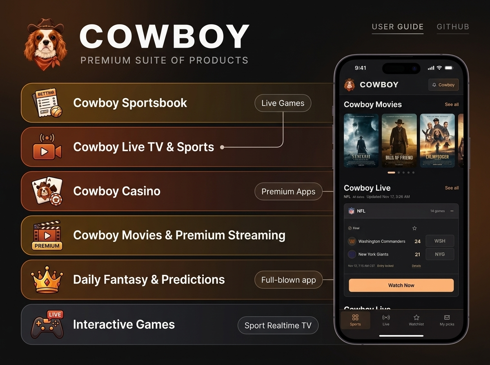
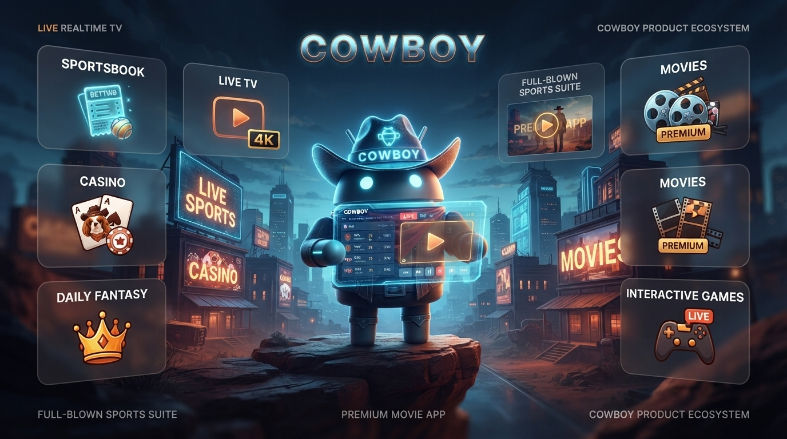
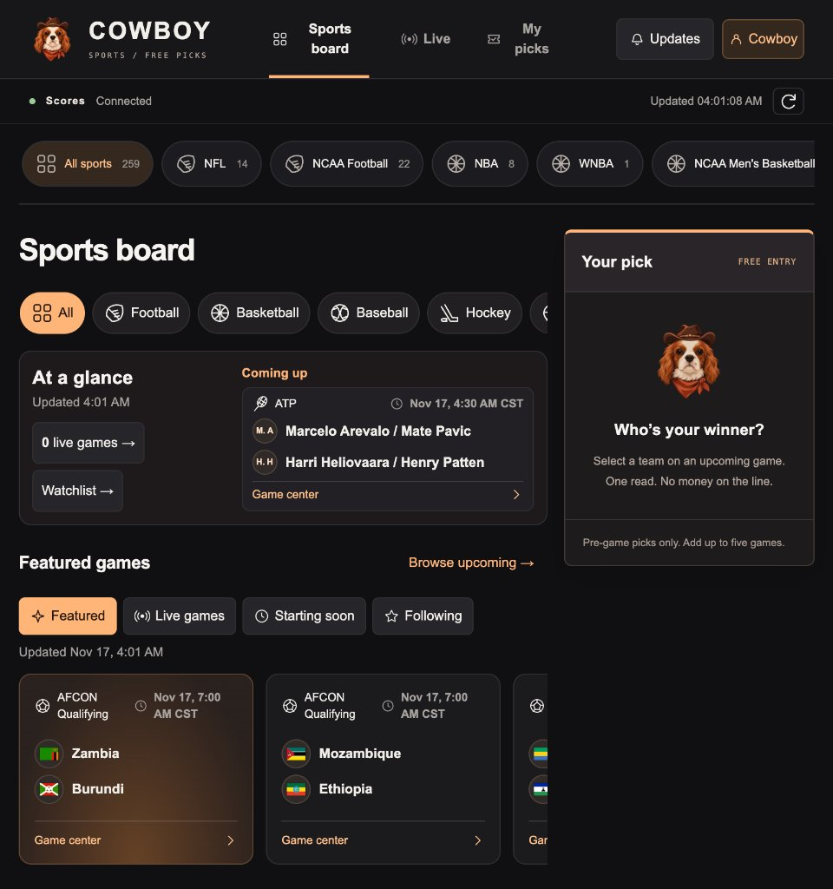
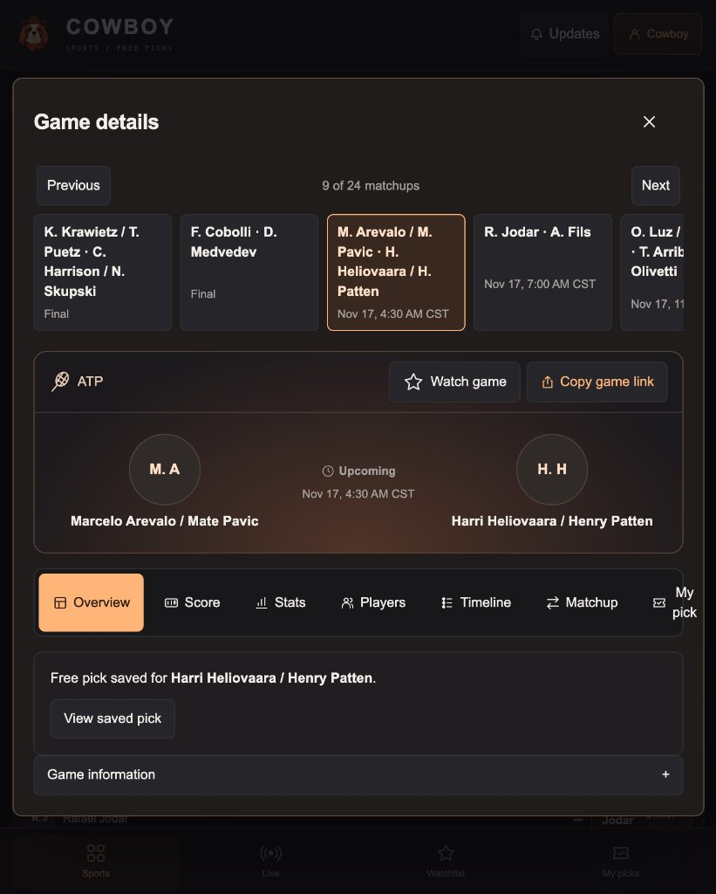

<div align="center">
  
  <br/><br/>
  <h1>COWBOY</h1>
  <p><strong>A bold, premium sports & entertainment suite · Real-time scores, multi-platform streaming, and interactive prediction play.</strong></p>
  <p>
    <a href="https://github.com/e93byte/COWBOY/actions/workflows/ci.yml"></a>
    
    
    
    
  </p>
  <p>
    <a href="#the-cowboy-ecosystem">Ecosystem</a> •
    <a href="#cowboy-in-action">Sports App</a> •
    <a href="#key-features">Key Features</a> •
    <a href="#try-cowboy-locally">Quick Start</a> •
    <a href="#useful-commands">Commands</a> •
    <a href="#project-map">Architecture</a>
  </p>
</div>

---

## The COWBOY Ecosystem

COWBOY is an integrated sports-and-entertainment suite engineered for high-performance live engagement. Spanning native television interfaces, mobile devices, desktop, and responsive web clients, the ecosystem connects sports fans to real-time data, high-definition streaming sources, and interactive picks under one unified brand.

| Suite Product | Core Capabilities | Supported Platforms | Status |
| :--- | :--- | :--- | :--- |
| **COWBOY Sports** | Real-time scoreboards, multi-league schedules, box scores, play-by-play, and free 5-pick draft. | Web • iOS • Android (PWA) | **Core Engine (In This Repo)** |
| **COWBOY Live TV & Sports** | Live event streaming, channel aggregation, and low-latency sports broadcast playback. | Android TV • Android Mobile • iOS • macOS | **Active Multi-Platform App** |
| **COWBOY Sportsbook & Odds Engine** | Multi-provider odds routing (ESPN, MLB, NHL, The Odds API), line movement, and bet builder. | Web • Node.js Router • API Gateway | **Functional Data Layer** |
| **COWBOY Movies & Streaming** | Premium entertainment discovery, on-demand movie streaming, and video catalog playback. | Android TV • Mobile • Desktop | **Integrated Media Suite** |
| **Daily Fantasy & Predictions** | Skill-based prediction challenges, streak leaderboards, and matchup contests. | Cross-platform | **Active Service** |
| **Interactive Games & Arcade** | Real-time in-game moments, mini-games, and companion second-screen entertainment. | Cross-platform | **Integrated Suite** |

<p align="center">
  
</p>

> [!TIP]
> **Architecture Overview:** This repository delivers the primary web experience for **COWBOY Sports**: our production-grade Next.js 16 live scoreboard, resilience score-routing layer, and free-to-play picks engine. Native TV applications (such as Android TV APKs) and companion mobile streaming clients interface with the shared COWBOY data and media backends.

---

## COWBOY in action

The screenshots below highlight the sports experience currently running in this repository: real multi-league schedules, in-game period breakdowns, team rosters, and free draft picks.

<p align="center">
  
  
</p>

---

## Key features

- ⚡ **Multi-League Live Scoreboard:** Track NFL, NBA, WNBA, MLB, NHL, NCAA Football & Basketball, Premier League, UEFA Champions League, UFC, and ATP/WTA Tennis with automatic live polling.
- 🎯 **Free Five-Pick Draft:** Pure prediction tracking without stakes, cash prizes, or wagering fees. Results lock at scheduled kickoff and grade authoritatively when final scores post.
- 🛡️ **Responsible Play Controls:** Built-in daily pick limits, optional cooling-off pauses, and browser-level self-exclusion.
- 🔁 **One-Tap "Pick Again":** Quick re-selection workflow on eligible settled, postponed, or cancelled fixtures.
- 📱 **Mobile & Tablet Optimized:** Responsive touch-first UI engineered and tested for 390px mobile screens and tablet viewports without horizontal clipping.
- 🔄 **Fault-Tolerant Score Router:** Multi-tier fallback architecture that gracefully degrades to secondary scoreboards and cached slates during upstream provider delays.

---

## Try COWBOY locally

New to the project? You’ll need **Node.js 22** and **npm** installed.

### 1. Download the project

```sh
git clone https://github.com/e93byte/COWBOY.git
cd COWBOY
```

### 2. Install dependencies

```sh
npm ci
```

### 3. Start the app

```sh
npm run dev -- --hostname 127.0.0.1 --port 3213
```

### 4. Open it in your browser

Visit [http://127.0.0.1:3213](http://127.0.0.1:3213). Create a local test account, choose an upcoming matchup, and confirm a pick. No API key is needed to try the sample locally.

> **Windows?** Run the commands in PowerShell. If `npm` is not recognized, install Node.js 22, then close and reopen your terminal.

## Explore the sports app

| Area | What you can do |
| --- | --- |
| **Sports board** | Browse schedules by sport, league, and date. Follow matchups and make up to five independent free picks. |
| **Watchlist** | Keep track of games you follow and return to them later. |
| **Live** | Follow games in progress, browse recent finals, or compare selected matchups. |
| **Game Center** | Explore available scores, play-by-play, lineups, player stats, and standings. |
| **My Picks** | Review your record and recent results. Eligible picks can be changed before a game starts. |
| **Preferences** | Choose your schedule time zone and followed-game alerts. |

Availability varies by sport and data provider. If a score source is temporarily unavailable, COWBOY may show backup or recently saved information and label it accordingly. Score updates are not a live video stream.

## Useful commands

Run these from the project directory:

| Command | What it does |
| --- | --- |
| `npm run dev` | Start the local development server. |
| `npm run typecheck` | Generate Next.js types and check TypeScript. |
| `npm test` | Run the unit tests. |
| `npm run build` | Create a production build. |
| `npm run start` | Serve the production build (run `npm run build` first). |
| `npm run test:e2e` | Run the Playwright browser tests. |

For browser tests, install Chromium once with `npx playwright install chromium`. Tests use port 3210 by default. To run them against the app on port 3213, use:

```sh
PLAYWRIGHT_BASE_URL=http://127.0.0.1:3213 npm run test:e2e
```

## Project map

| Location | What lives there |
| --- | --- |
| `app/components/` | Live-sports, game-detail, and account-pick interfaces. |
| `app/lib/` | Sports data, normalization, caching, and fallback logic. |
| `app/api/` | Sports, account, and pick API routes. |
| `public/sw.js` | Offline scoreboard support. |
| `tests/` | Unit tests, fixtures, and browser journeys. |
| `docs/` | Data-source notes and public reference materials. |

## Local data and privacy

Local account data is stored in `.cowboy-data/`. To store it somewhere else, set `COWBOY_DATA_DIR` to an **absolute path**. Keep private data and secrets out of Git. Before hosting the app for other people, review the storage and deployment setup for your environment.

### Optional score fallback

Set `SPORTSDB_KEY` on the server to enable TheSportsDB as a rate-limited fallback after the public LiveScore/OpenLigaDB paths. The app keeps this key server-side, caches one daily sport feed briefly, validates team identity and timestamps, and labels the result as delayed/backup internally. The public test key is not suitable for production; obtain a licensed key from TheSportsDB before enabling it in a hosted deployment. If the variable is absent, the app skips this provider without changing the primary ESPN path.

## Need a hand?

- Check [`docs/`](docs/) for score-source and project reference notes.
- If something is broken, [open an issue](https://github.com/e93byte/COWBOY/issues) and include what you expected, what happened, and the command or page involved. **Never include passwords, tokens, or private account data.**

## Contributing

Small, clear contributions are welcome. Before opening a pull request, run the checks relevant to your change:

```sh
npm run typecheck
npm test
npm run build
```

If you change a user journey, also run the browser tests. Please keep contributions beginner-friendly and preserve the clear distinction between free picks and gambling.
