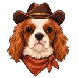

<div align="center">
  
  <h1>COWBOY</h1>
  <p><strong>Premium suite of products</strong></p>
  <p>
    <a href="https://github.com/e93byte/COWBOY/actions/workflows/ci.yml"></a>
    
    
  </p>
</div>

---

## What COWBOY stands for

COWBOY is a bold, premium sports-and-entertainment brand. The long-term product vision brings several experiences together under one recognizable identity, with a polished experience and the COWBOY mascot at the center.

This repository currently delivers the COWBOY sports experience: live sports scores, schedule browsing, and free picks. Picks have no stakes, payouts, or prizes. The sections below describe the broader COWBOY ecosystem as a brand vision and product direction—not features currently implemented in this repo.

| Product area | Purpose | Status |
| --- | --- | --- |
| **COWBOY Sportsbook** | Live scores, match tracking, matchup insights, and free picks. | **Available in this repo** |
| **COWBOY Live TV & Sports** | Streaming, sports broadcasting, and live event viewing. | Vision only |
| **COWBOY Casino** | Entertainment and table-game experiences. | Vision only |
| **COWBOY Movies & Streaming** | Movie discovery and premium streaming content. | Vision only |
| **Daily Fantasy & Predictions** | Leaderboards, free entries, and skill-based prediction play. | Vision only |
| **Interactive Games** | Mini-games, live engagement, and entertainment features. | Vision only |

> The broader product-suite imagery is best understood as a brand concept. The code in this repository is focused on the sports board, live updates, and free-pick experience. It does not include paid gaming, media streaming, or wagering features.

## Screenshots

<p align="center">
  
</p>

<p align="center">
  
  
</p>

<p align="center">
  
</p>

These screenshots should live in `docs/screenshots/` and show the current COWBOY sports experience and the premium product direction.

## Try COWBOY locally

New to the project? You’ll need **Node.js 22** and **npm** installed.

### 1. Download the project

```sh
git clone https://github.com/e93byte/COWBOY.git
cd COWBOY
```

### 2. Install dependencies

```sh
npm ci
```

### 3. Start the app

```sh
npm run dev -- --hostname 127.0.0.1 --port 3213
```

### 4. Open it in your browser

Visit [http://127.0.0.1:3213](http://127.0.0.1:3213). Create a local test account, choose an upcoming matchup, and confirm a pick. No API key is needed to try the sample locally.

> **Windows?** Run the commands in PowerShell. If `npm` is not recognized, install Node.js 22, then close and reopen your terminal.

## Explore the sports app

| Area | What you can do |
| --- | --- |
| **Sports board** | Browse schedules by sport, league, and date. Follow matchups and make up to five independent free picks. |
| **Watchlist** | Keep track of games you follow and return to them later. |
| **Live** | Follow games in progress, browse recent finals, or compare selected matchups. |
| **Game Center** | Explore available scores, play-by-play, lineups, player stats, and standings. |
| **My Picks** | Review your record and recent results. Eligible picks can be changed before a game starts. |
| **Preferences** | Choose your schedule time zone and followed-game alerts. |

Availability varies by sport and data provider. If a score source is temporarily unavailable, COWBOY may show backup or recently saved information and label it accordingly. Score updates are not a live video stream.

## Useful commands

Run these from the project directory:

| Command | What it does |
| --- | --- |
| `npm run dev` | Start the local development server. |
| `npm run typecheck` | Generate Next.js types and check TypeScript. |
| `npm test` | Run the unit tests. |
| `npm run build` | Create a production build. |
| `npm run start` | Serve the production build (run `npm run build` first). |
| `npm run test:e2e` | Run the Playwright browser tests. |

For browser tests, install Chromium once with `npx playwright install chromium`. Tests use port 3210 by default. To run them against the app on port 3213, use:

```sh
PLAYWRIGHT_BASE_URL=http://127.0.0.1:3213 npm run test:e2e
```

## Project map

| Location | What lives there |
| --- | --- |
| `app/components/` | Live-sports, game-detail, and account-pick interfaces. |
| `app/lib/` | Sports data, normalization, caching, and fallback logic. |
| `app/api/` | Sports, account, and pick API routes. |
| `public/sw.js` | Offline scoreboard support. |
| `tests/` | Unit tests, fixtures, and browser journeys. |
| `docs/` | Data-source notes and public reference materials. |

## Local data and privacy

Local account data is stored in `.cowboy-data/`. To store it somewhere else, set `COWBOY_DATA_DIR` to an **absolute path**. Keep private data and secrets out of Git. Before hosting the app for other people, review the storage and deployment setup for your environment.

## Need a hand?

- Check [`docs/`](docs/) for score-source and project reference notes.
- If something is broken, [open an issue](https://github.com/e93byte/COWBOY/issues) and include what you expected, what happened, and the command or page involved. **Never include passwords, tokens, or private account data.**

## Contributing

Small, clear contributions are welcome. Before opening a pull request, run the checks relevant to your change:

```sh
npm run typecheck
npm test
npm run build
```

If you change a user journey, also run the browser tests. Please keep contributions beginner-friendly and preserve the clear distinction between free picks and gambling.
