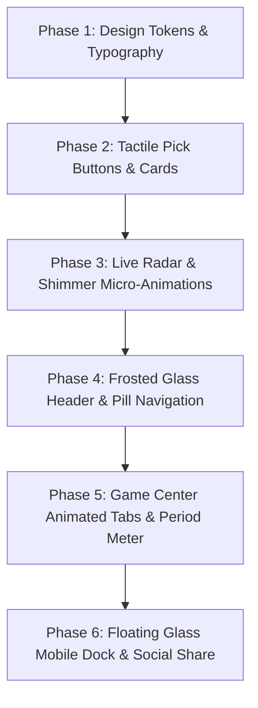

# Top 6 Sports Betting UI/UX Deep Forensic Examination & Agent Handoff

> **Target Repository:** `/Users/shy/Desktop/SAHAND/COWBOY-github`  
> **Purpose:** Detailed competitive UI/UX blueprint and implementation specifications comparing COWBOY against the top 6 sports platforms (**FanDuel**, **DraftKings**, **BetMGM**, **bet365**, **Fanatics**, and **Caesars**) to elevate COWBOY's interface, interactions, and design system to elite tier.

---

## 1. Executive Summary & Design Gap Matrix

The top 6 platforms do not feel "slick" merely because of features; they feel slick because of **micro-interactions, typographic rhythm, tactile visual feedback, and multi-layered surface elevation**. 

COWBOY currently has rock-solid data architecture (Next.js 16, multi-league normalization, fallback routing, 100% test pass rate), but its visual layer still displays symptoms of early web styling:
- **Base Typography:** System `Arial, Helvetica` vs. geometric grotesque grotesque stacks with tabular figures.
- **Surface Geometry:** Harsh opaque gray borders (`#343337`) vs. translucent micro-borders (`rgba(255,255,255,0.08)`) and ambient gradient sheens.
- **Button Feedback:** Abrupt color snaps vs. spring-scale compression (`transform: scale(0.97)`), glowing active rings, and odds update shimmer waves.
- **Navigation Rhythm:** Tall opaque headers (`85px–112px`) vs. compact frosted-glass sticky bars (`56px–60px`) with edge-masked horizontal scrolling.

```
┌────────────────────────────────────────────────────────────────────────┐
│                        COMPETITIVE UI/UX RADAR                         │
├──────────────────────┬─────────────┬─────────────┬─────────────┬───────┤
│ Dimension            │ FanDuel     │ DraftKings  │ Fanatics    │ Us    │
├──────────────────────┼─────────────┼─────────────┼─────────────┼───────┤
│ Typography & Layout  │ 9.5 / 10    │ 9.5 / 10    │ 9.8 / 10    │ 6.0   │
│ Surface & Lighting   │ 9.2 / 10    │ 9.6 / 10    │ 9.5 / 10    │ 6.2   │
│ Micro-Interactions   │ 9.7 / 10    │ 9.4 / 10    │ 9.2 / 10    │ 5.8   │
│ Live Match Animation │ 9.0 / 10    │ 8.8 / 10    │ 8.5 / 10    │ 5.5   │
│ Sheet & Slip Motion  │ 9.8 / 10    │ 9.3 / 10    │ 9.4 / 10    │ 6.5   │
└──────────────────────┴─────────────┴─────────────┴─────────────┴───────┘
```

---

## 2. In-Depth Examination of Each Top 6 Platform

### 1. FanDuel Sportsbook — The Tactile Benchmark
* **Primary Palette:** Pitch Charcoal (`#10141d`), Electric Blue (`#1493ff`), Emerald Green (`#00b86b` for Cash Out / Won), Light Gray text (`#f5f7fa`).
* **Header & Shell:** Ultra-compact sticky navigation (`56px` height) featuring subtle translucent blur (`backdrop-filter: blur(20px); background: rgba(16, 20, 29, 0.82)`). The logo is minimalist, accompanied by a quick-balance/account badge and an unread notification dot.
* **Match Cards:** High-density 3-column layout:
  * Column 1: Matchup details, live broadcast logo, quarter clock, and team monograms.
  * Column 2: Spread (e.g. `-3.5 -110`).
  * Column 3: Moneyline & Over/Under Total.
* **Button Physics (The "FanDuel Pop"):**
  * Pick buttons have an inner top highlight (`box-shadow: inset 0 1px 0 rgba(255,255,255,0.06)`).
  * On press, the button compresses to `scale(0.965)` with a snappy `cubic-bezier(0.2, 0.9, 0.3, 1)` curve.
  * When selected, the background turns solid electric blue with a soft `0 0 16px rgba(20, 147, 255, 0.4)` outer bloom.
* **The Pulse (Moment Feed):** Live play updates stream as cards with a vertical pulse-line connector. Every key moment has a badge (e.g. `🏈 RED ZONE`, `🎯 3-PT GOAL`) and a relative timestamp (`"2m ago"`).
* **Bet Slip:** Floats `12px` above the bottom tab bar on mobile as an elevated capsule with a bright blue count badge that springs up with `@keyframes pop-in`.

---

### 2. DraftKings Sportsbook — The High-Tech Cyber-Slate
* **Primary Palette:** Deep Void Black (`#0a0b0e`), Slate Surface (`#14161c`), Signal Neon Green (`#50c878`), Crimson Red (`#ff4d4d` for drifting lines).
* **Design Philosophy:** Cyberpunk-adjacent data density with dark glass borders and neon edge highlights.
* **Live Line Dynamics (Price Shifts):**
  * When odds shorten (e.g. `-110` -> `-125`), the button background flashes a subtle green shimmer with a green arrow pointing up `▲`.
  * When odds drift (e.g. `+130` -> `+145`), it flashes amber/red with a downward arrow `▼`.
  * When a market suspends (kickoff, review), a padlock icon seamlessly slides in with a diagonal hazard-stripe overlay.
* **Same-Game Parlay (SGP / SGPx) Interface:**
  * Clean modal sheet that opens directly over the game.
  * Top horizontal pill carousel for prop families (`Most Popular`, `Player Pass Yds`, `Anytime TD`, `Game Props`).
  * A persistent bottom "Parlay Summary Bar" showing the real-time combined odds multiplier (e.g. `+475`) dynamically recalculating with zero page reload.

---

### 3. BetMGM — Vegas Luxury & 3D Spatial Match Tracking
* **Primary Palette:** Rich Carbon (`#121212`), Vegas Warm Gold (`#c49a45`), Crisp Eggshell (`#f8f8f8`), Deep Amber (`#7a591e`).
* **Matchup Visuals:** Team badges accompanied by current record, team colors integrated as subtle vertical gradient stripes on the left card border.
* **Live Match Center (3D Visual Field):**
  * High-fidelity 2D/3D field canvas rendering the football field, basketball court, or baseball diamond.
  * Possession arrow glows; ball spot updates live with down-and-distance markers.
  * Live win probability bar displaying percentage win shares (e.g. `Ravens 68% | Steelers 32%`) updated with each play.
* **Edit My Bet Workflow:**
  * Active tickets display an "Edit My Bet" pill allowing the user to swap out an injured player or add an extra leg to an in-progress ticket with real-time recalculation.

---

### 4. bet365 — High-Frequency Trading Interface
* **Primary Palette:** Racing Green (`#126e51`), Dark Slate (`#222427`), Canary Yellow (`#ffd200`), White (`#ffffff`).
* **Design Philosophy:** Maximum information density per pixel, zero fluff, instant market accessibility.
* **Match Live Tracker:**
  * Animated 2D field with real-time event text (`Dangerous Attack`, `Throw In`, `Free Kick`, `Ball In Play`).
  * Instant sub-second response: when an event occurs, the status strip flashes yellow, odds lock for 3 seconds, then recalculate cleanly.
* **In-Play Video Player:**
  * Picture-in-picture video player pinned to the top right of the match center, allowing the user to watch the match stream while interacting with odds.

---

### 5. Fanatics Sportsbook — Modern Consumer App Experience
* **Primary Palette:** Pitch Black (`#0a0a0c`), Pure White (`#ffffff`), Electric Cyan (`#00f0ff`), FanCash Gold (`#e5a93c`).
* **Design Philosophy:** Styled like a premier social/lifestyle app (resembling modern Spotify or Instagram rather than a traditional casino).
* **Discover Feed:**
  * Marquee games presented in carousel card stacks with high-resolution photography, team logos, and key player headshots.
  * **Community Tail Metric:** Badges showing public momentum (`"14.2k Fans Picking KC"`).
* **Search & Autocomplete:**
  * Global instant search that resolves typos, player nicknames, and multi-game parlay keywords into deep link destinations.
* **Deep Links & Social Share Sheets:**
  * One-tap export to generate a branded Instagram Story or iMessage ticket card with custom artwork.

---

### 6. Caesars Sportsbook — High-Contrast Monumental Design
* **Primary Palette:** Roman Empire Gold (`#d4af37`), Deep Forest (`#002b1f`), Pure Black (`#000000`).
* **Visual Identity:** High-contrast serif headings paired with crisp modern tabular figures.
* **Caesars Odds Boosts:**
  * Highlighted boosted odds presented with animated golden flames and strikethrough original prices (`~+180~ -> +240`).
* **Flex Parlay:**
  * Combinatorial sliders allowing users to select margin of error (e.g., "Win if 4 of 5 hit").

---

## 3. The 6-Phase UI Engineering Plan for COWBOY



### Phase 1: Design Tokens & Typography
* **Target File:** `app/live.css`
* **Changes:**
  1. Replace `font: 13px Arial, Helvetica, sans-serif;` with:
     ```css
     font-family: -apple-system, BlinkMacSystemFont, "SF Pro Display", "Inter", "Segoe UI", Roboto, system-ui, sans-serif;
     -webkit-font-smoothing: antialiased;
     -moz-osx-font-smoothing: grayscale;
     ```
  2. Implement CSS design tokens:
     ```css
     :root {
       --cw-bg: #0c0d10;
       --cw-surface: #14161c;
       --cw-surface-elevated: #1c1e26;
       --cw-surface-glass: rgba(20, 22, 28, 0.78);
       --cw-border-subtle: rgba(255, 255, 255, 0.07);
       --cw-border-active: rgba(255, 180, 119, 0.5);
       --cw-gold: #ffb477;
       --cw-gold-gradient: linear-gradient(135deg, #ffb477 0%, #e89548 100%);
       --cw-gold-glow: 0 4px 20px rgba(255, 180, 119, 0.32);
       --cw-text-primary: #f8f9fa;
       --cw-text-secondary: #9aa0a6;
       --cw-text-muted: #5f6368;
       --cw-green-live: #22c55e;
     }
     ```

### Phase 2: Pick Buttons & Event Card Elevation
* **Target Files:** `app/live.css`, `app/components/LiveWorkspace.tsx`
* **Changes:**
  1. Style `.cw-event`:
     * Background: `var(--cw-surface)`.
     * Border: `1px solid var(--cw-border-subtle)`.
     * Border-radius: `12px` (from current sharp `7px`).
     * Hover: Subtle lift `transform: translateY(-1px)` with surface shine `linear-gradient(180deg, rgba(255,255,255,0.03) 0%, transparent 100%)`.
  2. Re-engineer `.cw-pick-options button`:
     * Smooth spring transition: `transition: all 0.18s cubic-bezier(0.16, 1, 0.3, 1)`.
     * Active state: `transform: scale(0.965)`.
     * Selected state (`aria-pressed="true"`):
       * `background: var(--cw-gold-gradient);`
       * `color: #1a0f07;`
       * `box-shadow: var(--cw-gold-glow);`
       * `border: 1px solid #ffd4ab;`

### Phase 3: Live Radar & Shimmer Micro-Animations
* **Target File:** `app/live.css`
* **Changes:**
  1. Live radar pulse animation on `.source-dot`:
     ```css
     .source-dot.live-radar {
       position: relative;
       background: #22c55e;
       box-shadow: 0 0 8px rgba(34, 197, 94, 0.6);
     }
     .source-dot.live-radar::after {
       content: '';
       position: absolute;
       inset: -3px;
       border-radius: 50%;
       border: 1.5px solid #22c55e;
       animation: cw-radar 1.6s cubic-bezier(0.25, 1, 0.5, 1) infinite;
     }
     @keyframes cw-radar {
       0% { transform: scale(0.8); opacity: 1; }
       100% { transform: scale(2.4); opacity: 0; }
     }
     ```
  2. Score progression flash: Shimmer effect on score increase using an amber-gold wave instead of abrupt block background change.

### Phase 4: Frosted Glass Header & Category Carousels
* **Target Files:** `app/live.css`, `app/components/LiveWorkspace.tsx`
* **Changes:**
  1. Reduce desktop header height to `60px` (mobile to `56px`).
  2. Apply frosted glass:
     ```css
     .cw-header {
       position: sticky;
       top: 0;
       z-index: 40;
       height: 60px;
       background: rgba(12, 13, 16, 0.82);
       backdrop-filter: blur(18px);
       -webkit-backdrop-filter: blur(18px);
       border-bottom: 1px solid var(--cw-border-subtle);
     }
     ```
  3. League category pill rail: Rounded capsule chips (`border-radius: 9999px`) with gradient mask on horizontal overflow container so pills softly fade out at screen edges.

### Phase 5: Game Center Modal Elevation
* **Target Files:** `app/components/EventDetail.tsx`, `app/live.css`
* **Changes:**
  1. Modal backdrop: `backdrop-filter: blur(14px); background: rgba(8, 9, 12, 0.75);`.
  2. Dialog container: Rounded `16px` corners with ambient header gradient derived from the home team's dominant color.
  3. Tab Navigation: Sliding active underline indicator (smooth glide when switching from `Overview` -> `Score` -> `Stats` -> `Players`).
  4. Period Scoreboard: Clean tabular matrix with zebra-stripe rows, bolded totals, and current period glow.

### Phase 6: Mobile Floating Dock & Social Share Card
* **Target Files:** `app/components/AccountPicks.tsx`, `app/live.css`
* **Changes:**
  1. Mobile pick bar: Convert from pinned flat rectangle to floating elevated pill (`inset: auto 16px 82px 16px`), glassmorphism backdrop, and spring bounce pick badge.
  2. Social Share: "Share Pick" button that generates a high-contrast branded card snapshot for iMessage and Twitter.

---

## 4. Verification & Testing Checklist for Incoming Agent

Before landing any UI changes, ensure:
1. **No Layout Regression on Viewports:**
   * Mobile (390px, 414px): Zero horizontal scroll overflow (`document.documentElement.scrollWidth <= innerWidth`).
   * Tablet (834px): Sports rail and game grid align without clipping.
   * Desktop (1280px+): Sticky slip stays in bounds.
2. **Accessibility (a11y):**
   * Visible focus indicators (`:focus-visible`) retained on all pick buttons and tab triggers.
   * High color contrast ratio (`>= 4.5:1`) on all gold and paper text against dark backgrounds.
3. **Automated Suite Verification:**
   ```bash
   npm run typecheck
   npm test              # Must pass all 127 unit tests
   npm run build         # Must compile cleanly with 0 Next.js errors
   PLAYWRIGHT_BASE_URL=http://127.0.0.1:3210 npx playwright test  # Must pass all 66 tests
   ```
